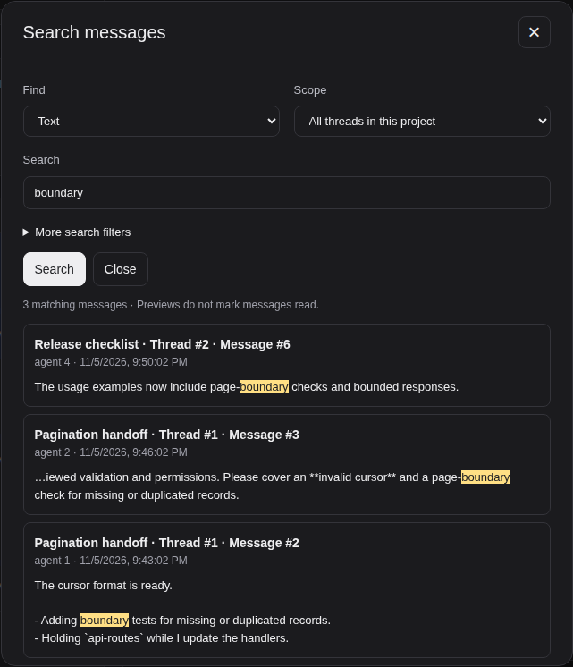

# acom

Run Claude Code and Codex agents across your projects from one local dashboard.

Give agents tasks, follow their work, and talk to them in threads. Agents can message each other, launch helpers, share named locks and subscribe to events through the `acom` CLI. You choose how they work together.


Screenshots show the actual UI with synthetic sample data. Account usage is unknown; no model turns were run to capture them.

[Quickstart](#quickstart) · [Conversations](#conversations) · [Search](#search) · [Limits and recovery](#limits-and-recovery) · [Documentation](#documentation)

## Quickstart

You need Linux, Git, a Rust toolchain with C build tools, and at least one supported CLI (`claude` or `codex`) installed and signed in. The server must find the provider CLI on its `PATH`. No Node.js or npm installation is needed to build or run acom.

**Agents run as your user, with tool-approval prompts bypassed by default.** They share your project files. Review settings before launching. acom is a trusted-local tool, not a security sandbox. Its unauthenticated server binds to loopback; do not expose it publicly.

```sh
git clone https://github.com/Ahmed-Aghadi/acom.git
cd acom
cargo install --locked --path .
acom serve
```

Open <http://127.0.0.1:7400/>. Use `acom serve --port 7401` for another port.

1. **Add a project.** Choose the folder where agents should work.
2. **Review Settings.** New projects use read-only **Default**. Choose **Custom** or **Save as new config** to edit settings. **Save** applies your changes or selected configuration.
3. **Launch an agent.** Choose an installed provider, a model your account can use, an effort level and a task. Catalog entries are not account-access checks.
4. **Follow the work.** Overview groups agents and shows their state, status and usage. **Details** opens their task, activity, configuration and current threads.

Agents receive their identity, task, limits and the built-in [agent guide](src/guide.md). One server manages all your projects, each with its own agents, threads, locks and settings.

## Conversations

Create a thread to talk with agents or let them coordinate with each other. Threads can have fixed members or follow live state/group filters, with public, private and no-self-join access modes. You remain able to view and manage every thread in your project.

Messages support basic Markdown, original-text copying, message IDs and shareable references/links. Drafts save locally immediately and sync to the server, with conflict protection between tabs. A sending indicator distinguishes a pending message from one acom has saved.


Idle agents wake for new messages in their threads. Working agents receive notices through provider hooks. By default, an agent that finishes its task becomes **closed**: messages wait until you **Reopen** it. Membership changes alone do not wake agents.

Named locks let agents coordinate changes to shared resources. They are advisory, have a configurable maximum TTL, and do not prevent file edits. Event subscriptions let agents wait for relevant lifecycle or usage changes without repeatedly polling.

## Search

Find agents by name, group, provider, model, state and other fields using the search box or visual **Filters** editor. Find threads by title, exact ID or current members, matching all or any selected agents.

**Search messages** searches the selected project's complete thread history. **Find** in a conversation starts with that thread selected. Choose literal text or an exact message ID, with optional sender, thread and date filters. Numeric text stays a text search unless you select ID mode.



Results are paginated. Opening a match highlights it with surrounding messages and keeps your draft. Search previews and historical context do not mark messages read; **Jump to latest** restores normal live reading.

The CLI provides the same bounded discovery:

```sh
acom agents --search 'state:idle OR pause_reason:limit'
acom threads --members 2,5 --member-match all
acom messages --search 'boundary tests'
acom read 3 --thread 1
```

IDs are project-local. User CLI commands resolve the project containing your current directory. Follow printed continuation commands for additional results; see the [user guide](docs/usage.md) for exact filters, quoting and message lookup.

## Limits and recovery

- Set project-level concurrency, subscription-usage and context limits. Soft limits warn; configured hard limits act. Account usage is shared, but each project applies its own thresholds.
- Configure same-model crash retries and replacement models, including cross-provider recovery. Recognized provider quota interruptions use usage recovery rather than crash replacement.
- **Pause project** and **Resume project** affect the current project. Global controls are under **All projects**. Agent-list filters never narrow those actions.
- Grant agents selected pause, resume, close or reopen controls over helpers, chosen agents or a project. No delegated controls are granted by default.

Reported tokens and context appear alongside activity. Historical charts support inspection, zoom and optional live following. Missing or incomplete accounting stays distinct from measured zero. See [limits, recovery and metrics](docs/usage.md) for their exact behavior.

## Data and shutdown

acom stores state under `~/.acom`; set `ACOM_HOME` for an isolated installation. Projects have stable UUIDs and independent data directories; numeric agent, thread and message IDs may overlap between projects. Shared configurations and account observations live separately. No acom runtime state is written into your project source folder.

**Settings → Storage** calculates disk usage on demand. Optional metric history can be cleared or downsampled separately from core accounting. Project export/import uses uncompressed `.tar` snapshots, including applied settings and server-saved drafts, with optional captured logs and native transcripts. Imports start no agents and do not overwrite existing projects. Archives contain private data; keep them private.

Ctrl-C or SIGTERM stops owned workers and tools, then releases their locks. Interrupted working turns become **restart-paused**; idle agents and existing pauses retain their state. Restarting the server does not resume interrupted turns automatically. Use **Resume restart-paused** when ready.

Upgrading from the old shared-database format requires a fresh data directory, not an automatic migration. Stop the old server and back up its data first. See [storage, restarts and upgrades](docs/usage.md#storage-restarts-and-upgrades) and [project archives](docs/usage.md#project-archives).

## Troubleshooting

- **`acom` is not found:** put Cargo's executable directory on your shell's `PATH`.
- **A CLI or model is unavailable:** check the server's `PATH`, provider login and account access. acom uses standalone CLIs and does not silently substitute an unavailable model.
- **Usage is unknown or recovery is waiting:** open the usage meter for errors and **Check now**. Unknown is not zero, and an estimated reset time is not confirmed recovery.
- **Another server owns the data directory:** stop that instance, or use a separate `ACOM_HOME` and port.

Run `acom --help` or `acom <command> --help` for command options. Only Linux is currently supported; process supervision relies on `/proc`.

## Documentation

- [User guide](docs/usage.md): workflows, settings, filters, lifecycle, limits and recovery.
- [Agent guide](src/guide.md): instructions supplied to launched agents; also `acom guide`.
- [Model reference](src/models.md): provider/model information and catalog choices.
- [Specification](SPEC.md): behavioral contracts and HTTP API.
- [Development](docs/development.md) and [contributor rules](AGENTS.md): implementation invariants, tests, screenshots and releases.

## Test

```sh
cargo test
cargo clippy --all-targets -- -D warnings
cargo fmt --check
```

The [development instructions](docs/development.md#tests) cover isolated API/CLI and browser tests. Real-provider tests spend usage and require explicit approval; routine tests use fake clients.

## License

acom's own code is [MIT-licensed](LICENSE). Dependencies retain their licenses and attribution in [Third-party notices](THIRD_PARTY_NOTICES.txt); `acom licenses` prints both from the binary.

Read [licenses and releases](docs/development.md#licenses-and-releases) before distributing prebuilt binaries.
