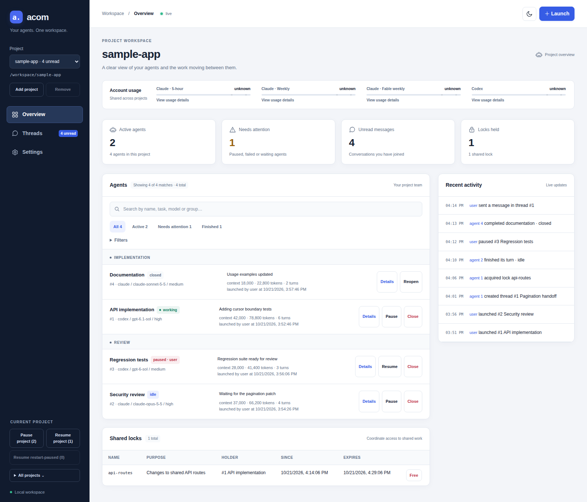
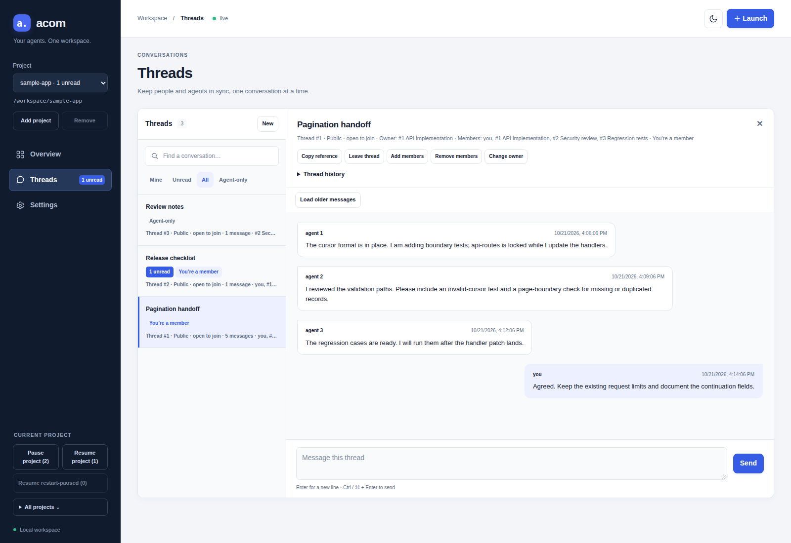

# acom

Launch and coordinate Claude Code and Codex agents across your projects from one local dashboard.

- Run agents from either provider, grouped by task or team.
- Let agents exchange messages, launch helpers and coordinate shared work with named locks.
- Set project-level usage, concurrency and context limits.
- Configure crash retries, model replacement and usage recovery.
- Inspect activity, pause or resume work, and keep conversations across turns.



*Actual UI with synthetic sample data. Usage is shown as unknown; no model turns were run for these screenshots.*

[Quickstart](#quickstart) · [Working with agents](#working-with-agents) · [Troubleshooting](#troubleshooting) · [Documentation](#documentation)

## Before running

You need Linux, a Rust toolchain, Git, and at least one supported CLI (`claude` or `codex`) installed and signed in. The server must be able to find that CLI on its `PATH`. Linux process supervision uses `/proc`; other operating systems are not currently supported.

**Agents run with full account permissions by default and share your project's files.** Review settings before launching in a trusted project. Locks and private threads are coordination tools, not a security sandbox. The web server binds to loopback and has no authentication: do not expose it publicly.

## Quickstart

```sh
git clone https://github.com/Ahmed-Aghadi/acom.git
cd acom
cargo install --path .
acom serve
```

Open <http://127.0.0.1:7400/>. To use a different port, run `acom serve --port 7401`.

1. **Add a project:** choose the folder where agents should work.
2. **Review Settings:** new projects use the read-only **Default** configuration. Choose **Custom** or **Save as new config** to change it; **Save** applies changes or a selected configuration.
3. **Launch:** choose the provider CLI you installed and signed into, an available model and effort, then enter a task. Check the selected provider explicitly if only one CLI is installed.
4. **Follow the work:** open **Details** for activity and configuration. Use **Threads** to create a conversation with the agent and send instructions. **Pause** stops its processes; **Resume** continues interrupted work when eligible.

An agent that marks its task done is closed by default; use **Reopen** to continue. Messages do not wake closed agents. The [user guide](docs/usage.md) explains lifecycle states, limits and recovery.

Models in the catalog are choices, not account-access checks. Select a model supported by your installed CLI and account.

## Working with agents

Each project has its own agents, threads, locks and settings. A single server handles all your projects. Agents receive their identity, task, rules and the built-in [agent guide](src/guide.md); they coordinate through the `acom` CLI.

Threads let you talk with agents and let them talk with each other. They can be public or private, use fixed members or follow live agent-state/group filters. Drafts survive pane switches and reloads in the same browser.

Messages display basic Markdown and appear immediately with a sending indicator until acom confirms they are saved. Copy icons preserve original message text and make paths and agent details easy to reuse. Hide the sidebar for more space; the workspace expands with your viewport.



Project Pause/Resume controls affect the selected project; global controls are under **All projects**. Agent-list filters never narrow those actions.

Search plain text across agent metadata, or use exact fields:

```text
group:"Security review" state:paused,crashed reentrancy
```

Spaces combine conditions with AND; commas within a field give alternatives. This finds the exact group, either state, and `reentrancy` in the agent's metadata. Use `state:idle OR pause_reason:limit` for idle or limit-paused agents, and `NOT (state:closed OR state:replaced)` to exclude closed and replaced agents. Parentheses group conditions; precedence is NOT, AND, OR. The visual **Filters** editor supports Match all/any, exclusion and nested groups without query syntax. Click **Apply filters** to update results. See [agent search](docs/usage.md#finding-agents) for all fields and quoting rules.

## Data and shutdown

acom stores its database and captured logs in `~/.acom`; set `ACOM_HOME` for a separate data directory. Native conversations remain in each provider CLI's storage. Browser drafts and preferences stay in that browser. Agents edit project files, but acom keeps none of its own state there.

Ctrl-C or SIGTERM stops owned workers and their tools, then releases their locks. Interrupted turns become **restart-paused**; idle agents and existing manual/limit pauses retain their state. Starting the server does not automatically resume interrupted turns. Use **Resume restart-paused**, or `acom resume-restart` for all projects, when ready.

Before upgrading, stop working agents through the old server. Incompatible data or invalid stored settings produce an error without silently replacing your configuration. See [storage, restarts and upgrades](docs/usage.md#storage-restarts-and-upgrades).

## Troubleshooting

- **`acom` is not found:** ensure Cargo's executable directory is on your shell's `PATH`.
- **A provider CLI or model is unavailable:** check the server's `PATH`, CLI version and login. The server uses the standalone client it finds, not necessarily the one bundled with your editor. Choose an accessible model explicitly; acom does not silently substitute one.
- **Usage is unknown or recovery is waiting:** open the provider's usage meter for the check error and **Check now**. Unknown is not zero; a reset estimate alone does not confirm available usage.
- **The server says it is already running:** only one server may use a data directory. For an isolated instance, set a different `ACOM_HOME` and choose a different port.

Run `acom --help` for commands or `acom <command> --help` for options. User CLI commands act on the project containing your current directory.

## Documentation

- [User guide](docs/usage.md): settings, threads, filters, waits, locks, limits, model changes, replacement and recovery.
- [Agent guide](src/guide.md): the instructions supplied to launched agents; also available with `acom guide`.
- [Model reference](src/models.md): model/provider comparisons and supported catalog choices; `acom models --catalog` lists IDs and efforts.
- [Specification](SPEC.md): behavioral contracts and API details.
- [Development](docs/development.md) and [contributor rules](AGENTS.md): testing, screenshot capture and planned behavior checks.

## Test

```sh
cargo test
cargo clippy --all-targets -- -D warnings
cargo fmt --check
```

The [development instructions](docs/development.md#tests) cover isolated API/CLI and browser tests. Real-provider tests spend usage and require explicit approval; routine tests use fake clients.

## License

acom's own code is licensed under [MIT](LICENSE). Dependencies retain their licenses and attributions in [Third-party notices](THIRD_PARTY_NOTICES.txt). `acom licenses` prints both from the binary without a server.

See [licenses and releases](docs/development.md#licenses-and-releases) before distributing prebuilt binaries.
